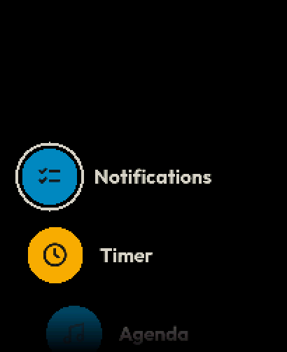
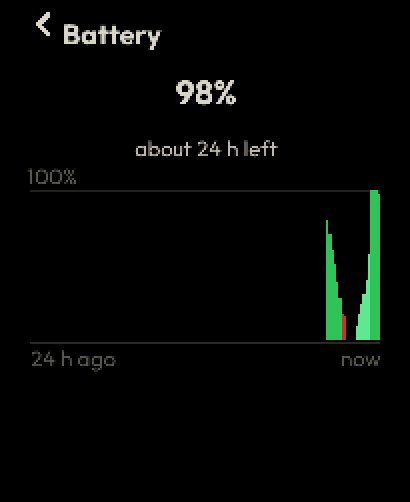
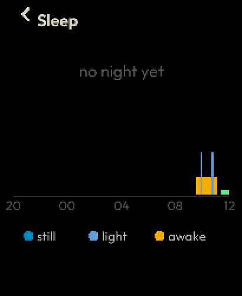
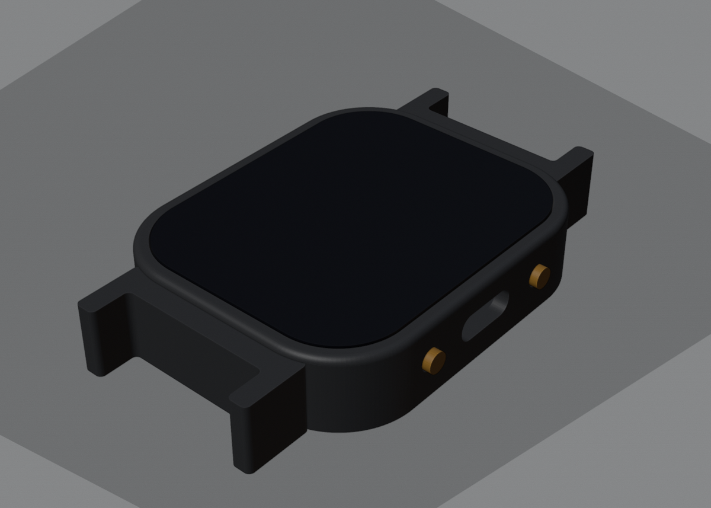
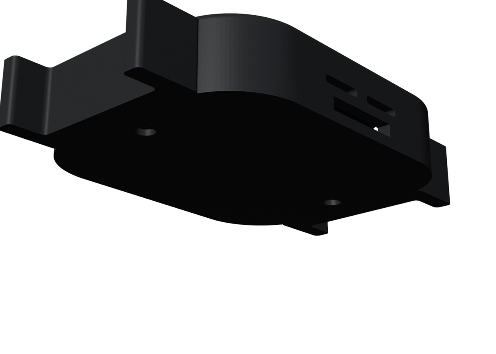
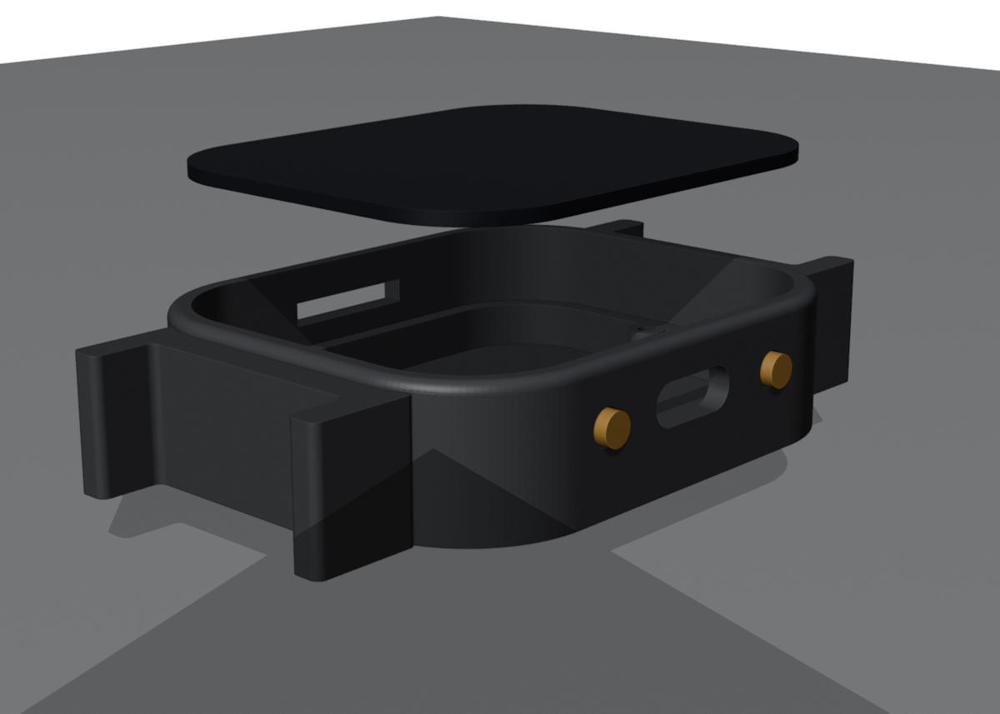

# Kode Watch

A DIY smartwatch with its own operating system, built on the
[Waveshare ESP32-S3-Touch-AMOLED-2.06](https://www.waveshare.com/esp32-s3-touch-amoled-2.06.htm) board.

It is built on the [kode-sdk and kodeOS](#built-on-kode) by **[Kode](https://kode.diy)**, the makers of the Kode Dot, and it features their mascot **Kody**. The watch OS, the apps and the watch faces are written in C on ESP-IDF. It doesn't use LVGL. A custom framebuffer renderer draws text, rounded shapes, rings and icons at about 30 fps.

<p>
  
  
  
</p>

## Case (work in progress)

A custom 3D-printed case, modelled in CadQuery. The screen and board form the top lid; screws come up through the bottom into the board.

<p>
  
  
  
</p>

## Hardware

- ESP32-S3R8 with 8 MB PSRAM and 32 MB flash
- 2.06" AMOLED screen, 410×502, with FT3168 capacitive touch
- QMI8658 motion sensor, AXP2101 power management, real-time clock
- Speaker, SD card slot and 2 buttons
- 400 mAh battery

## Features

- Watch faces, timer, alarm and a step counter
- iPhone notifications over Bluetooth (ANCS): open, read and delete them on the watch
- Music control (Home Assistant media players, Apple Media Service over Bluetooth)
- Calendar for the coming 7 days
- Find my iPhone: makes your phone ring through Home Assistant
- Sleep tracking (motion in 5-minute buckets) and a 24-hour battery graph
- Smart home rooms (lights) through Home Assistant
- File browser and a small app store
- Wi-Fi manager: saves up to 8 networks and switches to the strongest known one

## How it works

```
 watch  <── WebSocket (text lines) ──>  hub  <──>  Home Assistant
   │                                     │
   └── Bluetooth (ANCS/AMS/CTS) ── iPhone └── OTA images, remote logs, screenshots
```

The watch keeps a WebSocket open to a small Python hub (`hub/server.py`). They exchange line-based text messages such as `st ...`, `log ...`, `cal ...` and `mu ...`. The hub does the heavy lifting:

- talking to Home Assistant;
- serving over-the-air (OTA) updates;
- collecting remote logs and live screenshots of the watch screen, for debugging without a cable.

> **Note:** the hub currently runs on a home server. The plan is to move it onto a Kode Dot so that the Dot acts as the watch's hub.

## Updates and rollback

Each new firmware version is marked good only once it reaches the hub. If it doesn't reach the hub within 3 minutes, the watch restarts and boots the previous version again (`CONFIG_BOOTLOADER_APP_ROLLBACK_ENABLE`).

## Building the firmware

You need ESP-IDF v6.1.

```bash
cd firmware
idf.py set-target esp32s3
idf.py build flash monitor
```

### Configuration over USB serial

Wi-Fi credentials and the hub address are never compiled in. Set them over USB serial (or use the on-watch Wi-Fi screen):

```
cfg ssid <network>
cfg pass <password>
cfg url wss://your-hub.example.com/ws-dev
cfg key <device key>
cfg save
```

`cfg show` prints the current settings. `cfg list` and `cfg forget <ssid>` manage the saved networks.

The default hub URL and app store use the placeholder `hub.example.com`. Change `DEFAULT_URL` in `firmware/main/net.c` and `STORE_BASE` in `firmware/main/os.c` to point at your own hub.

## Running the hub

```bash
pip install aiohttp numpy pillow
cp hub/home.example.json hub/home.json   # edit: HA URL, rooms, calendars, player, phones
echo "<long-lived HA token>" > hub/ha_token && chmod 600 hub/ha_token
KODE_PORT=8001 python3 hub/server.py
```

The hub expects a reverse proxy that does the login and sets a `Remote-User` header, for example Authelia.

## Repository layout

```
firmware/   ESP-IDF project (main/ = OS + apps, components/ = NimBLE helper, bareiron)
hub/        Python/aiohttp hub server, OTA page, screenshot tool
docs/img/   screenshots and case renders
```

## Tips for ESP32-S3 watches

- **Internal RAM is the bottleneck, not PSRAM.** Put Wi-Fi/LWIP, mbedTLS and NimBLE allocations in PSRAM.
- **Bluetooth and TLS together:** with Bluetooth on, use software AES, or stop Bluetooth before a TLS download.
- **FT3168 touch:** read it only while the INT pin is low or a finger is down. Blind polling gives periodic NACKs.
- **Timers:** use signed time differences, `(int32_t)(now - t) < x`.

## Built on Kode

Kode Watch is a community project built on the work of **[Kode](https://kode.diy)**, the makers of the **Kode Dot**. It is not an official Kode product.

- **[kode-sdk](https://github.com/kodediy/kode-sdk)** and **[kodeOS](https://github.com/kodediy/KodeOS)** by Kode. kodekit (`kk.c`), the type, glyphs and look of the UI are ported from them (GPL-3.0-or-later).
- **Kody**, the character and its animations, is art of Kode, licensed [CC BY-SA 4.0](https://creativecommons.org/licenses/by-sa/4.0/). This repo contains only the player and the build tool (`tools/kodyframes.py`). The watch renders Kody's frames at build time from kodeOS.
- **Kode, Kode Dot, kodeOS and Kody** are names and trademarks of Kode. See Kode's trademark guidelines (`TRADEMARKS.md` in [kodediy/.github](https://github.com/kodediy/.github)).
- The fonts that come from the kode SDK are licensed under the SIL Open Font License 1.1.

Docs: [docs.kode.diy](https://docs.kode.diy/sdk/overview)

## License

GPL-3.0-or-later, see [LICENSE](LICENSE). Exceptions:

- the art of Kody: CC BY-SA 4.0, © Kode;
- the fonts: SIL OFL 1.1;
- `components/nimble_peer`: based on Espressif's NimBLE examples (Unlicense / CC0-1.0).

This project also includes [bareiron](https://github.com/p2r3/bareiron) (GPL-3.0).
